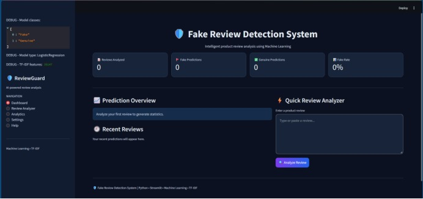
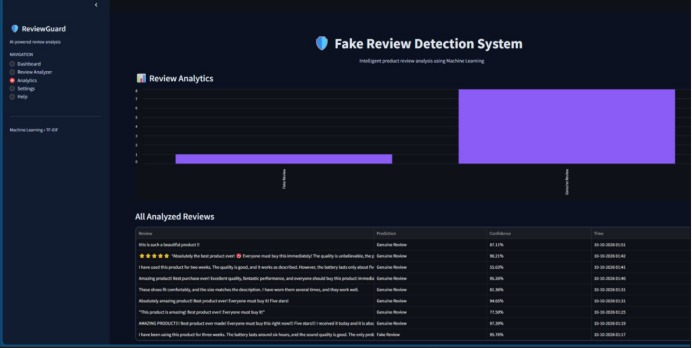
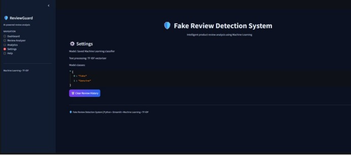
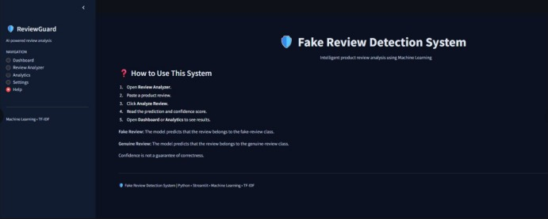

# Fake Review Detection System

## 1. Project Overview

The **Fake Review Detection System** is a machine learning project that identifies whether a product review is **Fake or Genuine**.

It uses Natural Language Processing (NLP), TF-IDF and Logistic Regression to analyse review text and predict its category.

The main aim of this project is to help users identify fake product reviews and make better decisions.

## 2. Technologies Used

- **Google Colab** – Model training and experimentation
- **VS Code** – Streamlit website development
- **Python** – Programming language
- **Streamlit** – Web application development
- **Pandas** – Data handling
- **Joblib** – Saving and loading the trained model
- **Scikit-learn** – Machine learning
- **TF-IDF** – Text feature extraction
- **Logistic Regression** – Classification algorithm

## 3. Model Information

- **Machine Learning Algorithm:** Logistic Regression
- **Text Feature Extraction:** TF-IDF
- **Dataset Size:** 40,432 reviews
- **Training and Testing Split:** 80% training and 20% testing
- **Model Accuracy:** Approximately 90.34%
- **Prediction Classes:** Fake Review and Genuine Review

## 4. Project Workflow

1. Review dataset collection and preparation.
2. Text cleaning and preprocessing.
3. Feature extraction using TF-IDF.
4. Model training using Logistic Regression in Google Colab.
5. Model evaluation using test data.
6. Saving the trained model and TF-IDF vectorizer.
7. Integrating the model into the Streamlit web application.
8. Entering a review and getting a prediction.

## 5. Project Files

- `app.py` – Main Streamlit application code
- `requirements.txt` – Required Python libraries
- `fake_review_model.pkl` – Trained machine learning model
- `tfidf_vectorizer.pkl` – Trained TF-IDF vectorizer

## 6. How to Run the Project

### Step 1: Install Python

Install Python on your computer.

### Step 2: Download the Project

Download or clone this GitHub repository to your computer.

### Step 3: Install Required Libraries

Open the project folder in VS Code and run:

```bash
pip install -r requirements.txt
```

### Step 4: Check Project Files

Make sure `app.py`, `fake_review_model.pkl` and `tfidf_vectorizer.pkl` are in the same project folder.

### Step 5: Run the Application

Run the following command in the terminal:

```bash
streamlit run app.py
```

The Streamlit application will open in your web browser.

## 7. Main Features

- Review text input
- Fake and Genuine review prediction
- Prediction confidence percentage
- Review history
- Dashboard and analytics

*Features listed here should be checked against the final working application.*

## Project Screenshots

### 1. Dashboard



### 2. Review Analyzer


### 3. Analytics



### 4. Settings



### 5. Help



## 8. Project Team

- **Diya Sen** – BWU/BTS/24/537
- **Trisa Barai** – BWU/BTS/24/532
- **Siuli Bouri** – BWU/BTS/24/533

## 9. Project Guides

- **Ria Pyne**
- **Dr. Vandana Yadav**

## 10. Project Purpose

This project demonstrates how machine learning and natural language processing can be used to identify potentially fake product reviews.

It provides a simple web interface where users can enter a review and view the predicted result.
